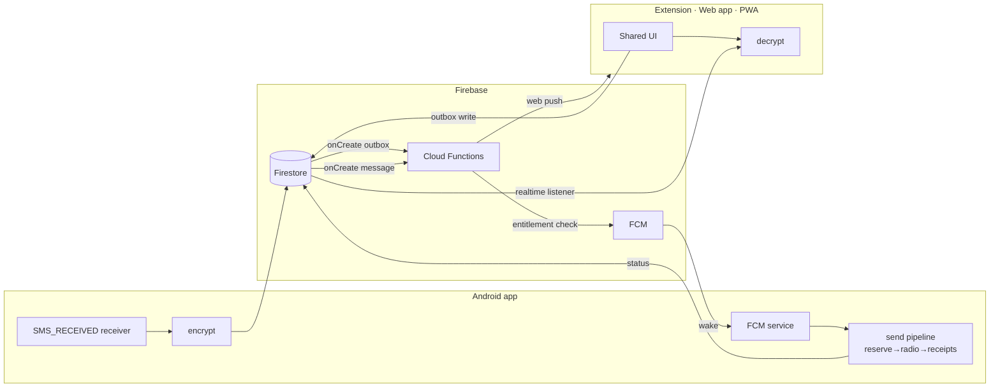

# Voiceish 2.0 — Design (approved 2026-11-12)

Status: **approved design, not yet implemented.** Supersedes the 0.1.4 LAN architecture in `DOCS/ARCHITECTURE.md` once Phase 1 begins; ARCHITECTURE.md/CHECKLIST.md will be rewritten as the 2.0 snapshot during implementation.

## Context
Voiceish 0.1.4 works, but it asks too much of users: sideload two APKs, paste a JSON pairing key, stay on the same Wi-Fi, run a foreground server, re-enter the IP when it changes. The operator has never used it because of that friction. The goal is a commercial product in the MightyText category that a beginner can set up in under a minute and use from anywhere:
- the Chrome extension on any of their computers
- the web app on another Android device or tablet
- a full-screen web app

It should be gated by a paid entitlement and have best-in-class design. Security should be **reasonable and marketable** ("end-to-end encrypted, we can't read your texts"), not hardened. Every 0.1.4 assumption can change.

**Next step:** implement through `/sc:implement`, phase by phase (§9).

## 1. Architecture decision: cloud relay, no LAN server
| | 0.1.4 | 2.0 |
|---|---|---|
| Connectivity | Phone runs an HTTP server on the LAN; browser must be on the same Wi-Fi | **Firebase relay**: phone and clients talk to Firestore; works over any network |
| Waking the phone | Persistent foreground service + wake lock | **FCM high-priority push** wakes the phone to send. No always-on service, so better battery |
| Identity / pairing | JSON key pasted by hand | **Google sign-in (one tap) on both sides + one "Allow" tap on the phone** |
| Content security | AES-GCM with a shared key | **End-to-end: one account data key, handed to each new device only after the phone approves it** |
| Distribution | Two sideloaded APKs | **Google Play** (fallback: the existing Setup installer, distributed from the site) |

**Retired:** `LocalServer`, pairing text, extension `optional_host_permissions`, `site-bridge.js`, the LAN-only/no-hosted-service rules, `build-native.sh`.

**Kept and ported:** the idempotent send pipeline (reserve the send in local storage before handing it to the radio, a dedupe key per `sendId`, no automatic retransmit, `unknown` state). It now keys off the cloud outbox document ID. Also kept: the receipt state machine (`SmsStore`), the navy/cobalt/gold design system (`source/web/DESIGN.md`), and the cross-language crypto interop test pattern (`tests/crypto-interop.mjs`).



## 2. Security model (reasonable, marketable)
- **Account data key (DK):** a 32-byte AES-GCM key generated on the phone. Message bodies, contact names and phone numbers are encrypted with it before they leave the phone. Firestore sees only ciphertext, timestamps and direction.
- **Threads without exposing phone numbers:** `threadId = HMAC-SHA256(DK, normalizedNumber)`, so the server can group messages into conversations without knowing the number.
- **Adding a device:** a new client signs in and generates a P-256 key pair. The private key is non-extractable in the browser (a WebCrypto CryptoKey kept in IndexedDB). It publishes the public key. The phone shows a notification: "Allow *Chrome on MacBook* to see your texts?" On **Allow**, the phone wraps DK for that device (ECDH, then HKDF, then AES-KW) and writes the wrapped copy to the device's document. That one tap is the whole security ceremony; no codes to compare.
- **Revoke:** remove the device in any client's settings. The function deletes its document and FCM token. Optionally rotate DK on the phone, which re-wraps it for the remaining devices.
- **Losing the phone** means old cloud history can't be decrypted. A new phone creates a new DK, and old ciphertext ages out through Firestore TTL. That's acceptable because the phone's own SMS store is the record.
- **Abuse protection:** Firebase App Check (Play Integrity on Android, reCAPTCHA Enterprise on web/extension). Security rules restrict every path to its owner, and only Cloud Functions write entitlements.

## 3. Data model (Firestore)
```
users/{uid}                         { createdAt, displayName }
users/{uid}/devices/{deviceId}      { kind: phone|extension|web, name, pub, fcmToken, wrappedDK?, approved, lastSeen }
users/{uid}/threads/{threadId}      { lastAt, unread, enc{address,name,snippet} }
users/{uid}/messages/{msgId}        { threadId, at, dir: in|out, status, enc{body}, expireAt }   ← TTL 90 days
users/{uid}/outbox/{sendId}         { threadId, enc{to,body}, subId, status: queued|sending|sent|failed|unknown, error?, createdAt }
users/{uid}/commands/{cmdId}        { type: ring|stop|locate, from, status: queued|ringing|stopped|found|expired, at, expireAt }   ← TTL 1 day
entitlements/{uid}                  { status: trialing|active|past_due|canceled|none, plan, periodEnd, source, customerId }  ← functions-only write
usage/{uid}_{yyyymm}                { sends }                                                        ← functions-only write
```
**Rules sketch:**
- `users/{uid}/**` is owner-only.
- **Paid-only gate (operator rule: cost must scale with revenue):** every read and write under `users/{uid}/**` and `circles/**`, plus `outbox`/`commands`/clip creation, requires `get(entitlements/uid).status in [trialing, active]`. Rules evaluate the gate once per request or listener (one billed read), so a lapsed account costs only its blocked attempts. The device-approval and entitlement documents themselves stay readable so onboarding and the paywall can render.
- `entitlements` and `usage` are owner-readable only.

Emulator tests cover the rules.

## 4. Core flows
1. **Onboarding (target: under 60 s, 3 screens):**
   - Install from Play, then tap "Continue with Google" (Credential Manager one-tap).
   - Grant permissions on a single explainer screen: SMS, plus notifications. The app explains each permission in plain language.
   - The app shows "Now open **voiceish.app** on your computer" and an **Install Chrome extension** QR/link.
   - On the computer: sign in with Google, **start the 14-day trial** (Polar checkout, card on file, about 20 s; required before the paid-only gate opens), then the phone pings "Allow Chrome on …?", tap Allow, and the inbox appears with the last 30 days synced.
2. **Inbound SMS:** the receiver handles the SMS, the app encrypts it, writes message and thread, and a function sends a web push to the approved clients. The push carries the encrypted snippet; the client decrypts it locally and shows the notification.
3. **Send:** the client writes an encrypted outbox document. The function re-checks the entitlement (defence in depth), increments usage for abuse monitoring, and sends a high-priority FCM to the phone. The phone runs the ported send pipeline (reserve before the radio, multipart, sent receipts) and updates the status, which clients see live.
4. **Messages the user types on the phone itself:** an incremental provider sync on every FCM wake and every receive, plus a WorkManager periodic job every 15 minutes.

## 4a. Find my phone (built-in companion feature)
**Main use case:** "it's somewhere in the couch." One big **Ring my phone** button in every client, plus extension toolbar right-click → "Ring phone" and a ⌘⇧R shortcut. It works with no setup beyond what onboarding already did.

**Ring flow:**
1. The client writes `users/{uid}/commands/{cmdId} {type: ring, from: deviceId, at}`.
2. `onCommandCreate` checks the sender is an approved device and applies a rate limit (for example 10 a minute), then sends high-priority FCM.
3. The phone starts a short foreground service (allowed from a high-priority FCM). It plays a loud alarm sound on the **alarm audio channel** (`AudioAttributes.USAGE_ALARM`), which plays even when the ringer is on silent or vibrate. Volume ramps up to maximum over 3 s and the original volume is restored afterward. The phone also vibrates, and blinks the flashlight when the screen is off.
4. A high-priority notification with a big **"Found it"** button stops it. So do the volume or power key, or **Stop** from any client. It stops automatically after 60 s.
5. The phone reports `ringing`, `stopped` or `found` back to the command document, so the client shows "Ringing… · tap Stop when found".

**Do Not Disturb:** alarms usually get through DND by default. An optional "Ring even in Do Not Disturb" toggle asks for Notification Policy access (`ACCESS_NOTIFICATION_POLICY`), explained in plain language, so the ring is guaranteed.

**Phone offline:** the command stays queued and the client shows "Phone offline · last seen 2 h ago, at 41% battery". Every check-in updates `lastSeen` and battery on the phone's device document. The ring fires automatically if the phone reconnects within 10 minutes. After that the command expires, so the phone doesn't start blaring hours later.

**Phase 2 (optional, adds Play review scope):**
- **Locate on a map:** latest location, fetched on demand when asked. Needs location permission, and background location requires Play's location declaration, where "find my device" is an accepted use.
- **Lost mode:** a lock-screen message ("If found, call +1…") and remote "mark as lost".

Remote wipe is deliberately excluded, since Google Find My Device already does it.

**Gating:** included in every paid plan and in the trial (paid-only rule, §6). Ring is still a headline landing-page feature ("Find your phone from your laptop"). Locate and Lost mode are part of Phase 2.

## 4b. Family walkie-talkie (push-to-talk, 1:1 and group)
**Model change:** this adds **multiple users**. Texting and Ring are scoped to one user's own devices. Walkie adds `circles` (a family or a group) with invites, so the members are other accounts.

**Approach (v1): hold-to-talk clips that play automatically on arrival.** This is how Zello and WhatsApp voice notes work, rather than a live call.
- **Talk:** hold the big button.
  - Android: the in-app button, a home-screen widget, a Quick Settings tile, or the **Bluetooth headset button** (MediaSession).
  - Extension and web: hold **Space** or the button.
- Audio is Opus (WebM/Ogg), uploaded in 1-second chunks *while* holding to Cloud Storage `circles/{cid}/clips/{clipId}/{n}`. Recipients start playing about 1 s behind the speaker, so it feels nearly live without needing a live media server.
- **Receive:** `onClipCreate` sends high-priority FCM to the members' devices.
  - With **Walkie mode on**: the phone starts a short media-playback foreground service and plays the clip **automatically**, including on the lock screen, like a real walkie-talkie. A "Reply" notification action opens hold-to-talk.
  - With Walkie mode off (or DND): the clip arrives as a voice note.
- Clips are kept for 7 days (Storage lifecycle rule and Firestore TTL). Each has a play-once indicator and "heard by" receipts.
- **Why not live audio for v1:** recorded clips survive poor connections and phones that are asleep, cost almost nothing, need no media server, and reuse the FCM path. **v2 option:** a live "open channel" through LiveKit Cloud (a WebRTC media server) for always-on family rooms.

**Family tie-ins (where the product stands out):**
- **"Ring Mom's phone":** a member can ring another member's phone if that member turned on "Family can ring me" (consent per member, revocable).
- **Shared "last seen and battery"** within the circle, opt-in. Family location stays in Phase 2 with the Locate feature.

**Security (reasonable, stated honestly):** clips are encrypted in transit and at rest by Google, and security rules limit access to circle members. They are **not end-to-end encrypted in v1**, unlike SMS, so marketing must say "private to your family", not "E2E". v2 can add a group key wrapped per member device, reusing the DK-wrapping code from §2.

**Data model additions:**
```
circles/{cid}                    { name, ownerUid, createdAt }
circles/{cid}/members/{uid}      { role: owner|member, displayName, allowRing, walkieAutoPlay, joinedAt }
circles/{cid}/clips/{clipId}     { from, to?: uid (1:1) , chunks, durationMs, status: recording|complete, heardBy{}, expireAt }
invites/{code}                   { cid, createdBy, expiresAt }   ← short code / link / QR; claimed via function
```
Rules: circle documents are readable only by members; clip upload requires membership; invites are claimed only through a function. A 1:1 conversation is a two-member circle, so there is one code path.

**Android extras:** `RECORD_AUDIO` permission, a `mediaPlayback` foreground service type, and the `microphone` foreground service type while recording from the widget or headset.

**Pricing:** add a **Family plan** of about $7.99/mo or $59/yr, covering up to 6 members (Polar supports per-seat or fixed-tier products). It includes Pro for every member. Families try it through the standard trial. Invited members are covered by the owner's Family plan; invitees without a covering plan see the paywall.

## 5. Clients and design
- **One UI codebase** (`packages/ui`, React + TypeScript + Vite) rendered in three shells:
  - full-screen PWA (Firebase Hosting)
  - Chrome extension (**side panel** as the primary surface, plus popup quick-reply and `chrome.notifications`)
  - the same PWA, installable on other Android devices and tablets
- **Android app:** Kotlin + Jetpack Compose (Material 3, brand palette). Its UI is deliberately small: status ("Connected · 3 devices"), devices, permissions health, plan status. Messaging happens on the big screens.
- **Design bar:** conversation list + thread layout, instant search, keyboard-first (⌘K, ↑/↓, Enter to send), unread and notification badges, dark and light themes, accessible to WCAG AA. Every error is written with a recovery action ("Phone offline, last seen 2 h ago. Open Voiceish on your phone."). Status chips show sending / sent / failed / check-phone. Empty states teach the next step.
- **Brand:** one name, "Voiceish", across every surface (currently "Voice-ish SIM" and "Voiceish" are mixed). MightyText is a positioning reference only; no copied design.

## 6. Entitlements and payment platform — recommendation: **Polar (merchant of record)**
Selling happens **on the web and extension**, where the value is used. The Android app is a free companion with **no purchase UI**: it only shows "Plan: Pro" or "Subscription required — manage on your computer", without a link, to stay clear of Play's billing and anti-steering rules.

| Option | Fit | Why |
|---|---|---|
| **Polar** ✅ | Best | Merchant of record: it collects and remits global VAT and sales tax, which a solo founder otherwise can't practically handle. Developer-first API and webhooks. `external_customer_id` maps directly to the Firebase `uid`. Hosted checkout plus a customer portal (cancel, change card). Low fees (about 4% + 40¢; check current pricing). |
| RevenueCat | Second / later | Its strength is App Store and Google Play in-app purchase. Use it **if** you later sell inside the Android app; Play Billing would then be required. Its Web Billing and Firebase integration could unify entitlements. Overkill for web-first sales. |
| Lemon Squeezy | Not chosen | Also a merchant of record, but since Stripe acquired it (2024) development has slowed and Stripe is moving users toward its own offerings. Platform risk, and slightly higher fees. |
| Plain Stripe | Not chosen (for now) | Cheapest per transaction, but **you** become the merchant of record and must register and remit tax worldwide (Stripe Tax calculates, it doesn't file). Reconsider beyond about $20–50k MRR. |
| WooCommerce | No | A WordPress storefront. Wrong shape for app entitlements and subscriptions tied to Firebase users. |

**Integration:**
- Checkout link with `external_customer_id = uid`.
- Polar webhook → `functions/polarWebhook` (verifies the Standard Webhooks signature) → upserts `entitlements/{uid}`.
- Rules and the outbox function enforce the entitlement. Clients subscribe to `entitlements/{uid}`, so the UI unlocks instantly after checkout.
- `entitlements.source` keeps the door open for RevenueCat or Play later.

**Pricing model: paid-only, no free tier.** Rationale: Firestore can't cap reads per user (rules allow or deny, they don't count), so the cost of a free account can't be bounded. With every active account paying, cost (≈ $0.07–0.40 per user per month) scales with revenue (≈ $4.40 net per Pro user) at about a 10× margin. Unpaid and lapsed accounts are blocked by rules and cost almost nothing.

**Tiers (adjustable):**
- **Pro:** about $4.99/mo or $39/yr, with unlimited sends, unlimited devices and 1-year history.
- **Trial:** 14 days, **card required at checkout** through Polar. This bounds abuse (no throwaway accounts at scale) and gives the trial a fixed end. The entitlement is set to `trialing` by the webhook and expires with the trial. Optional: a no-card 3-day trial behind App Check plus one-trial-per-phone-number, if conversion data later justifies it.
- **Cost guardrails anyway:** GCP budget alerts at 50/90/100%, a budget-triggered function that disables billing as a kill switch, App Check enforced, per-uid rate limits in functions, and usage counters for spotting anomalies.

## 7. Repository shape
```
apps/android      Kotlin/Compose; ports SmsEngine/SmsStore send+receipt logic
apps/web          PWA shell
apps/extension    MV3 shell (side panel, popup, background FCM/web push)
packages/ui       shared React components + design tokens (from DESIGN.md)
packages/core     crypto (DK, wrap/unwrap, threadId), Firestore models, entitlement client
functions         onOutboxCreate, onMessageCreate (push), polarWebhook, onDeviceDelete
firebase          firestore.rules, indexes, TTL policy, rules tests
```
0.1.4 moves to `legacy/` (or a git tag) for reference.

## 8. Risks (with mitigations)
1. **Play SMS-permission policy (critical path).** READ_SMS, SEND_SMS and RECEIVE_SMS are restricted. "Cross-device SMS synchronization" is a listed exception, but it needs the Permissions Declaration Form, a demo video and review. *Mitigation:* submit early with a minimal build. Fallback is direct APK distribution through the existing Setup installer (signer and hash checks kept).
2. **FCM delivery on aggressive OEMs** (Samsung, Xiaomi battery managers). *Mitigation:* high-priority data messages, battery-optimization guidance shown by the in-app health check, and the outbox showing "Phone hasn't picked this up" after 30 s.
3. **Firestore cost:** one write per message. TTL caps storage; cost is roughly cents per heavy user per month at typical volumes. Monitor with budgets.
4. **Firebase Blaze plan required** (needed for Cloud Functions).
5. MMS and RCS remain out of scope for v1 (as in 0.1.4), and are named on the roadmap.

## 9. Phases (each ends with tests passing)
1. **Foundation:** Firebase project (the Firebase MCP failed to connect this session; either reconnect it or have the operator create the project), rules + emulator tests, `packages/core` crypto with Java↔JS interop tests.
2. **Android:** Compose app, sign-in, device approval, receive sync, FCM-driven send (port of the send pipeline), **Ring my phone** (it shares the FCM command path, so it costs little to add and is the first working demo). Submit to the Play internal track early, for the policy review.
3. **Clients:** `packages/ui`, the PWA, then the extension side panel and notifications.
4. **Commerce:** Polar products, webhook function, entitlement gating, plan UI, trial.
5. **Polish and launch:** onboarding usability test with 3 beginners, accessibility pass, landing page, Play listing.
6. **Family walkie (after the texting launch, so it doesn't delay it):** circles and invites, hold-to-talk with chunked clips, auto-play foreground service, widget, Quick Settings tile and headset button, family Ring consent, Family plan in Polar. Later option: a live channel through LiveKit.

## Verification
- `firebase emulators:exec` runs the rules tests (owner isolation, outbox gated by entitlement, entitlement writes denied to clients) and the function tests (simulated Polar webhook → entitlement; outbox → FCM call mocked).
- Crypto interop: DK wrap/unwrap and `threadId` agree between Kotlin and WebCrypto; a revoked device can't unwrap a rotated DK.
- End to end on a real handset:
  - fresh install → onboarding in under 60 s, timed
  - receive SMS → desktop notification within about 3 s
  - send from the extension on cellular-only (no shared LAN) → delivered, status shows `sent`
  - cancel the subscription in the Polar sandbox → sending blocked with an upgrade prompt
  - phone on silent and face-down in the couch → Ring from the extension → loud within about 3 s; "Found it" stops it and the original volume comes back; the 60 s auto-stop works; a command older than 10 minutes never fires
  - walkie: a two-phone circle with the receiver locked and Walkie mode on → hold-to-talk on phone A → B plays automatically about 1–2 s behind; a non-member can't read or upload clips (rules test); a clip expires after 7 days
  - airplane mode → outbox shows `queued`, then delivers when back online, with no duplicate send
- Firestore dump shows no plaintext phone numbers or bodies.
